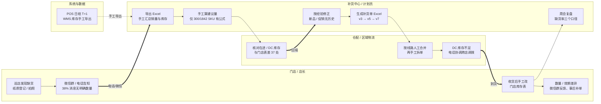
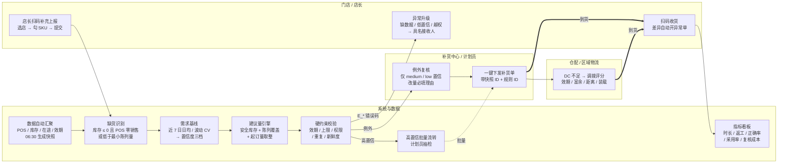

# 03 · 流程图源文件（Mermaid）

> 图片文件：`03-流程图-现状.png` / `.svg`、`03-流程图-数智化转型后.png` / `.svg`
> 本文保留可编辑的 Mermaid 源码，便于在 GitHub / VS Code / mermaid.live 中直接改。
> 图片由 `tools/gen_flow.py` 按泳道坐标生成（排版比 Mermaid 更可控），节点与连线与下面的源码一致。

---

## 一、现状流程图（人工模式）



**读图要点**

- 3 处人工转录：巡店登记 → 微信 → Excel → 邮件（每次转录都丢信息）。
- 2 处口径不一致：在途/DC 库存 vs 门店库存表；周会缺货率三个口径。
- 1 处无审批痕迹：差异只走微信群，事后补单。
- 关键结构性缺陷：门店收货后手工改表，使 WMS 与门店账长期不一致，反过来污染下一次建议量。

---

## 二、数智化转型后流程图（规则 + 例外管理）



**与原流程的差异**

| 环节 | 现状 | 转型后 |
|---|---|---|
| 缺货信号 | 店长口头/微信，38% 无数量 | 系统识别 + 店长 3 步补充，结构化入库 |
| 算量 | 计划员手工 Excel，仅 300 个 SKU 有公式 | 规则引擎统一公式，参数按品类可配 |
| 校验 | 事后追责（差异微信群反馈） | 事前硬约束（效期/上限/权限/重复/新鲜度） |
| 复核 | 全量人工核对 | 只审例外（预计约 12% 单据） |
| 调拨 | 电话协调、靠人情 | 5 因子评分 + 叶书审批 + 留痕 |
| 收货 | 手工改表，账实长期不符 | 扫码收货，差异自动开单 |
| 指标 | 周会三个口径 | 看板实时，口径唯一 |

---

## 三、如何重新导出图片

```bash
python3 tools/gen_flow.py          # 生成 docs/*.svg
python3 - <<'EOF'
import pymupdf
for f in ["docs/03-流程图-现状.svg", "docs/03-流程图-数智化转型后.svg"]:
    d = pymupdf.open(f)
    d[0].get_pixmap(dpi=150).save(f.replace(".svg", ".png"))
EOF
```
